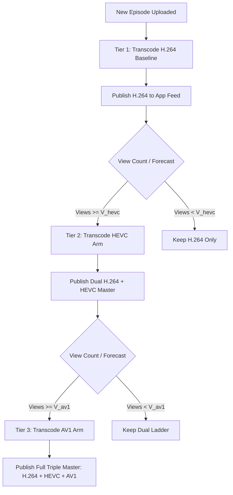

# ADR-003: Three-Codec Decision Matrix and Per-Title Encode Gate

- **Status**: Accepted
- **Date**: 2026-11-24
- **Context**: AV1 Adoption Kit for Vertical Drama Apps (v0.1)

---

## 1. Context and Problem Statement

Adopting next-generation video codecs (HEVC and AV1) introduces substantial cloud encoding costs:
- Encoding with **SVT-AV1** (even at production preset 8 with fast-decode enabled) requires 4× to 8× more CPU compute cycles than `libx264` (preset slow).
- Vertical drama catalogs produce vast volumes of short episodes (typically 50–100 episodes per drama title). A large long-tail of titles receives modest view counts, while a small percentage of viral "hit" dramas account for 80%+ of total CDN egress bytes.
- Blindly encoding every uploaded episode into H.264, HEVC, and AV1 creates immediate compute deficits that can easily outstrip any CDN bandwidth savings on the long tail.
- Furthermore, **hardware HEVC** is supported on over 85% of mobile devices globally, achieving roughly 44% bitrate reduction against H.264 with negligible battery impact and widespread hardware DRM support. AV1 offers an additional ~20% saving beyond HEVC (~55% below H.264), but software AV1 decode incurs battery and CPU overhead on older devices.

---

## 2. Decision

We establish:
1. A **three-codec evaluation matrix** comparing H.264, HEVC, and AV1 side-by-side.
2. A **runtime codec selection hierarchy** prioritizing hardware HEVC where it provides the majority of bandwidth savings with minimum playback risk.
3. A **per-title / per-episode encode gate** that triggers HEVC and AV1 transcoding only when expected or realized viewing minutes cross economic break-even thresholds.

### 2.1 Codec Decision Matrix

| Dimension | H.264 (Baseline) | HEVC (`libx265`) | AV1 (`libsvtav1`) |
| :--- | :--- | :--- | :--- |
| **Bitrate at Equal VMAF** | Reference (0%) | ~44% lower vs H.264 | ~55% lower vs H.264 (~20% vs HEVC) |
| **Hardware Decode Reach** | Universal (>99.9%) | High (>85% global fleet) | Growing (~3–15% depending on tier) |
| **Software Decode Path** | Not needed | Avoid on mobile (CPU heavy) | Platform `dav1d` on Android 12+ |
| **DRM Capability** | Widevine / FairPlay | Widevine L1 / FairPlay | Hardware only (no L1 with dav1d) |
| **Licensing** | Ubiquitous (MPEG LA) | Patent pools (MPEG LA, HEVC Advance) | Royalty-free (AOMedia) |
| **Role in this Kit** | Always-available fallback | Primary candidate on hardware HEVC | High-efficiency candidate on hardware AV1, or vetted software AV1 |

### 2.2 Client Selection Policy Priority
The client playback policy evaluates available streams in the following strict order:
1. **Hardware AV1**: If device possesses verified hardware AV1 decode for the target rung $\rightarrow$ Select AV1 master.
2. **Hardware HEVC**: If device supports hardware HEVC and HEVC ladder exists $\rightarrow$ Select HEVC master (captures ~44% saving with zero software decode risk).
3. **Software AV1 (`dav1d`)**: If Android device passes all eligibility gates (ADR-004) and AV1 ladder exists $\rightarrow$ Select AV1 master.
4. **Baseline H.264**: Default fallback for all remaining devices or on playback failure $\rightarrow$ Select H.264 master.

### 2.3 Per-Title / Per-Episode Encode Gate

Episodes are transcoded lazily through three economic tiers:

#### Break-Even Formulation
The threshold views ($V$) for an episode of duration $D$ minutes are calculated as:

$$V_{\text{breakeven}} = \frac{C_{\text{encode}}}{D \times \Delta_{\text{GB/min}} \times P_{\text{CDN}} \times S_{\text{eligible}}}$$

Where:
- $C_{\text{encode}}$: Total cloud compute cost to encode the ladder into the target codec (in USD).
- $D$: Episode duration in minutes (typically 1.0 to 1.5 min).
- $\Delta_{\text{GB/min}}$: Data savings per minute against H.264 baseline at target quality (in GB/min).
- $P_{\text{CDN}}$: Organization's contracted CDN egress price per GB (in USD/GB).
- $S_{\text{eligible}}$: Share of fleet watch time capable of playing the codec.

Episodes expected to achieve fewer than $V_{\text{breakeven}}$ views remain on H.264.

---

## 3. Consequences

### Positive
- Prevents runaway cloud encoding expenditure on low-viewership drama episodes.
- Maximizes return on investment by focusing compute resources on viral content.
- Protects mobile battery and thermals by leveraging hardware HEVC wherever AV1 hardware decode is absent.

### Negative / Trade-offs
- Two-tier publishing requires an asynchronous transcoding queue and playlist manifest updater in the backend CMS.
- Early viewers of a newly launched episode stream H.264 until view thresholds are reached.
